# RISC-V CoVE Threat Model (STPA-Sec)

This directory contains the threat model for RISC-V CoVE (Confidential VM Extensions) developed using a systematic methodology combining **STPA-Sec** (System-Theoretic Process Analysis for Security) and **Attack Graphs**.

The model was created within the Capella MBSE tool using the STPA and DARC Add-Ons, as detailed in our paper:
> **A Systematic Threat Modeling Methodology for Confidential Computing Architectures: a Case Study on RISC-V CoVE**

## Methodology Overview

Our approach follows a hybrid workflow that provides end-to-end traceability from high-level system hazards down to concrete attack paths:
1.  **STPA-Sec Analysis:** Modeling components, control actions, and feedback loops to identify safety/security artifacts (losses, hazards, UCAs, scenarios).
2.  **Security Analysis (DARC/STRIDE):** Mapping identified loss scenarios to the STRIDE taxonomy to clarify attacker objectives.
3.  **Attack Graph Generation (Mulval):** Refining the analysis from a practical attacker perspective to identify feasible exploit chains.
4.  **Experimental Validation:** Verifying vulnerabilities on the **Shadowfax** TEE platform.

---

## STPA Process Phases

### 1. Define Purpose of the Analysis
Establish the goals and boundaries of the security analysis by identifying what we want to protect and what can go wrong at a high level.

*   **Stakeholders and Stakes:**
    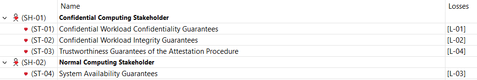

*   **Losses (L):**
    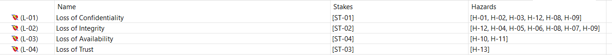

*   **System-Level Hazards (H):**
    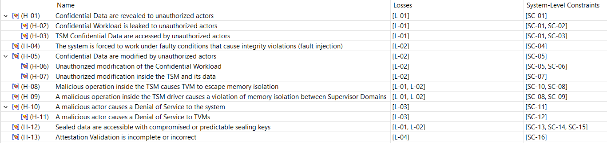

*   **System-Level Constraints (SC):**
    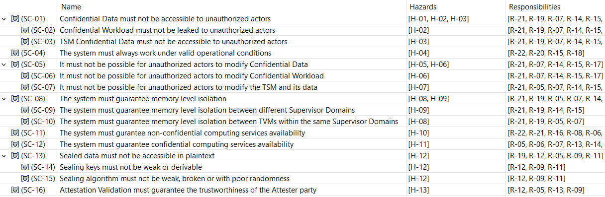

## Derived Security Requirements

Based on the analysis, specific security requirements and constraints are allocated to the components:

*   **Domain Manager Requirements:** 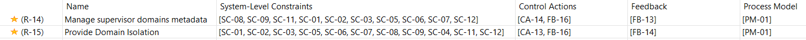
*   **Interrupt Manager Requirements:** 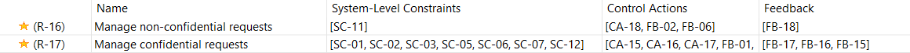
*   **PMP Requirements:** 

### 2. Model the Control Structure
Create a functional model of the system as a set of interacting feedback loops.

*   **Hierarchical Control Structure (HCS):**
    The HCS represents the system architecture in terms of control actions and feedback channels, compliant with the RISC-V Security Model.
    

*   **Detailed Controller Diagram (DCD):**
    For critical components like the **Domain Manager**, we detail internal state (Process Model) and constraints.
    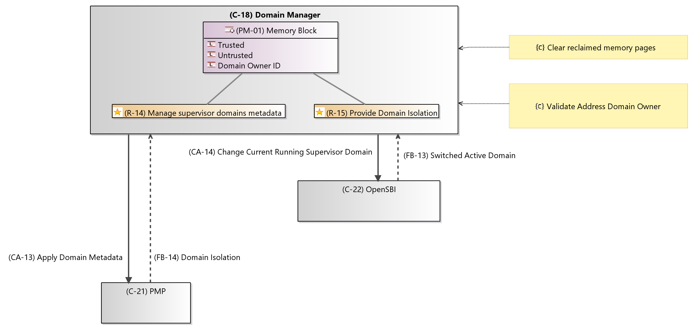

### 3. Identify Unsafe Control Actions (UCA)
Analyze how control actions (e.g., PMP configuration, memory conversion) can lead to hazards if provided incorrectly or not at all.

*   **UCA Table Example (Apply Domain Metadata):**
    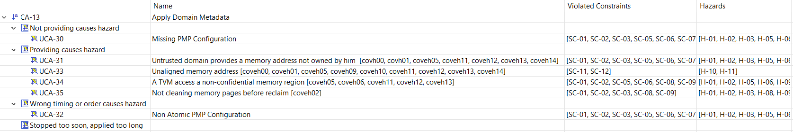

### 4. Identify Loss Scenarios
Identify the causal factors (e.g., compromised inputs, logic errors) that lead to UCAs and system losses.

*   **Causal Factor Diagram (UCA-31):**
    Analyzes how an untrusted domain can provide memory addresses it doesn't own.
    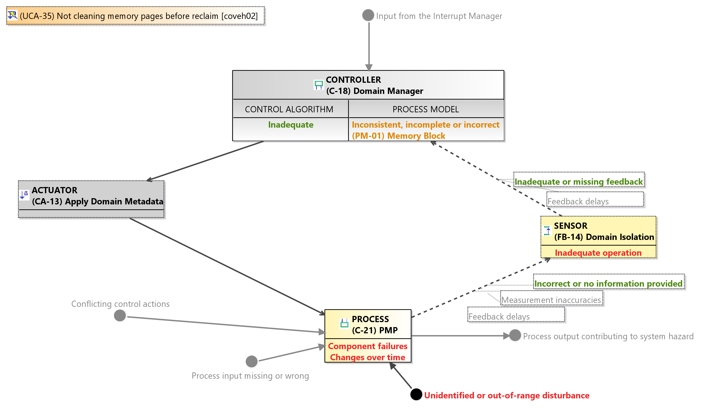

*   **Causal Factor Diagram (UCA-35):**
    Analyzes the not cleaning memory pages after the reclaim.
    **Causal Factor Diagram (UCA-35):*
    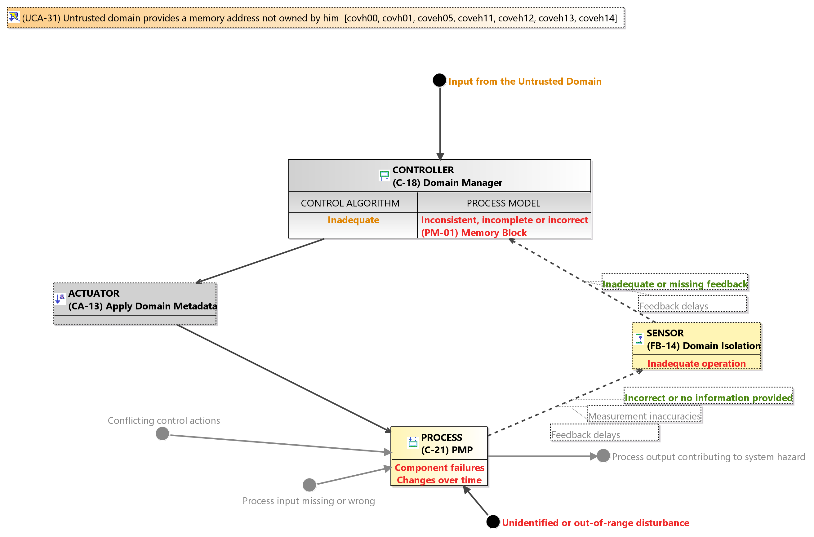

*   **Loss Scenario Table:**
    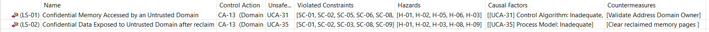
